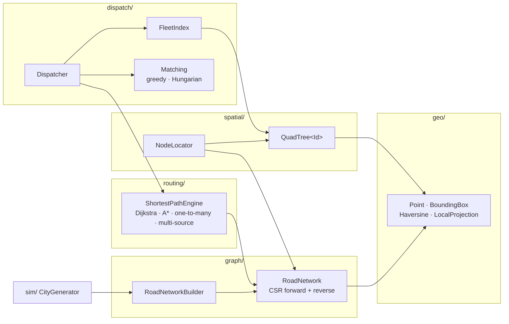

# Waypoint

**A real-time spatial routing and fleet dispatch engine in modern C++20.**

Waypoint answers the two questions behind every food-delivery or ride-hailing request:

1. **Which rider should take this order?** It shortlists nearby riders with a QuadTree, prices the shortlist with exact road-network ETAs, and assigns riders to orders individually or as a globally optimal batch.
2. **What is the fastest route?** It runs A* search on a directed, traffic-aware road graph, using a heuristic that is provably admissible.

It has no dependencies beyond a C++20 compiler and CMake. Every algorithm is checked against a brute-force reference in the test suite, and every performance number below comes from the benchmark in this repository.

---

## Highlights

| | Result (from [`bench/benchmark.cpp`](bench/benchmark.cpp), 40,000-intersection city) |
|---|---|
| **A\* vs Dijkstra** | **48.5% fewer nodes settled**, 41.5% faster, identical route costs over 1,000 random queries |
| **QuadTree k-nearest** | **112x faster** than a linear scan over 50,000 riders (3.2 µs vs 361 µs per query) |
| **Multi-source A\*** | Finds the fastest of 16 candidate riders while settling **96.4% fewer nodes** than one A\* per candidate |
| **Hungarian batch matching** | Serves **100% vs 98.8%** of orders and cuts total pickup time by **11.6%** compared with greedy dispatch |
| **End-to-end batch** | 30 orders shortlisted, priced and optimally matched in **~4.5 ms** |

---

## Architecture



Dependencies only point downward. `geo` knows nothing about graphs, `spatial` and `graph` know nothing about riders, and `dispatch` is the only layer with business concepts (orders, riders, assignments).

| Module | Responsibility | Key types |
|---|---|---|
| `geo` | Planar geometry in km, great-circle distance, lat/lng projection | `Point`, `BoundingBox`, `haversineKm`, `LocalProjection` |
| `graph` | Validated, immutable-topology road graph with live traffic | `RoadNetworkBuilder`, `RoadNetwork` |
| `routing` | All shortest-path queries, sharing one search loop | `ShortestPathEngine`, `Route` |
| `spatial` | Proximity indexing of moving objects; snapping GPS fixes to intersections | `QuadTree<Id>`, `NodeLocator` |
| `dispatch` | Rider pool, order-to-rider assignment | `FleetIndex`, `Dispatcher`, `CostMatrix` |
| `sim` | Deterministic synthetic cities for tests, demo and benchmarks | `generateCity`, `CityConfig` |

### The dispatch funnel

Each stage costs more per candidate than the one before, so each stage only sees what survived the previous one:

```
  Order at (x, y)
        │
        ▼
 ┌──────────────────────┐   QuadTree best-first k-nearest within radius R
 │ 1. SHORTLIST         │   O(log N + k) typical · straight-line distance
 └──────────┬───────────┘   50,000 riders  ->  ≤ 16 candidates
            ▼
 ┌──────────────────────┐   single order : one multi-source A* (fastest rider wins)
 │ 2. PRICE             │   batch        : one reverse one-to-many Dijkstra per order
 └──────────┬───────────┘   exact road ETAs: one-way streets, traffic, river crossings
            ▼
 ┌──────────────────────┐   single order : take the winner
 │ 3. ASSIGN            │   batch        : Hungarian algorithm on the ETA matrix
 └──────────────────────┘   (most orders served first, then minimum total ETA)
```

Why not just pick the closest rider in a straight line? Rivers, one-way streets and highways make straight-line distance a poor stand-in for travel time. The demo shows this directly:

```
=== 2. Single dispatch: straight-line nearest is not road nearest ===
  Rider #101: 0.16 km away in a straight line, ETA by road 4:33
  Rider #102: 0.45 km away in a straight line, ETA by road 1:17
  -> Dispatched rider #102 (pickup ETA 1:17)
```

---

## Algorithms and engineering decisions

### Road graph: CSR adjacency in both directions
`RoadNetwork` stores edges as two **compressed sparse rows**: outgoing arcs indexed by tail for forward search, and incoming arcs indexed by head for reverse search. A node's neighbours are contiguous in memory, so relaxing a node is a linear scan. Topology is frozen at `build()`. Traffic is the only mutable state, and updating it is an O(1) write to the edge's travel time.

Costs are **travel times in seconds**, not distances: `length / speed × traffic`.

### A* with a provably admissible heuristic
The heuristic is the straight-line distance to the target divided by the network's maximum speed. The builder **enforces** the invariants that make this safe:

- road length ≥ straight-line distance between its endpoints,
- speed ≤ `maxSpeedKmh()` (by definition),
- traffic multiplier ≥ 1 (`setTrafficMultiplier(0.5)` throws).

Under these rules h(u) ≤ c(u, v) + h(v) for every road, so the heuristic is **consistent**: A* returns exact optimal routes and never re-expands a node. Weighted A* (`aStar(s, t, w)`) is also exposed. With w = 1.5 it settles another 45% fewer nodes, and the worst route it returned in the benchmark was 2.2% slower than optimal (the theoretical bound is 50%).

### One search loop, four query types
`ShortestPathEngine` implements Dijkstra, A\*, one-to-many and multi-source search as one templated loop. They differ only in seeds, heuristic and stopping rule:

| Query | Seeds | Heuristic | Stops when |
|---|---|---|---|
| `dijkstra(s, t)` | {s} | 0 | t settled |
| `aStar(s, t, w)` | {s} | w · lower bound to t | t settled |
| `travelTimes(o, targets, dir)` | {o} | 0 | all targets settled |
| `nearestSource(sources, t)` | all sources at cost 0 | lower bound to t | t settled → winner is its origin |

Two implementation details keep queries cheap:

- **Lazy deletion instead of decrease-key.** A node whose cost improves is pushed again. Stale heap entries are skipped when popped.
- **Generation-stamped labels.** Per-node state is allocated once per engine and tagged with a query counter, so starting a query is O(1) rather than an O(V) reset. Query cost scales with the region explored, not with the map size.

### QuadTree for moving objects
- Entries live **only in leaves**. A leaf splits after `leafCapacity` entries, and **four sibling leaves merge back** when removals bring them under capacity, so the tree reflects where riders are now rather than where they have been.
- Child selection is O(1) arithmetic (`quadrantOf`). Points on a split line have exactly one home, so they cannot be duplicated or lost.
- `maxDepth` stops runaway subdivision when many riders report the same coordinate (a naive QuadTree recurses until the stack overflows).
- **Radius query** prunes quadrants that are disjoint from the circle and bulk-collects quadrants that lie entirely inside it.
- **k-nearest** is a best-first search over quadrants ordered by distance. It stops as soon as the nearest unexplored quadrant is farther away than the current k-th best.

### Optimal batch assignment
Greedy, first-come-first-served dispatch lets an early order take the only rider a later order could use. `matchOptimal` solves the rectangular assignment problem with the **Hungarian algorithm** (O(n²m)). Infeasible pairs (a rider out of range or unreachable) get a penalty larger than any complete feasible matching, so the solver **maximises orders served first**, then minimises total ETA. It is verified against exhaustive search on 300 random instances.

---

## Benchmarks

```bash
./build/waypoint_bench          # full run, about 12 s
./build/waypoint_bench --quick  # CI smoke run
```

Measured on one core of an Intel Xeon @ 2.10 GHz, GCC 13, `-O3` (CMake Release). Synthetic city: 200 × 200 jittered grid (40,000 intersections, 141,045 directed segments, 20 × 20 km), 20% one-way streets, arterials, closures, random congestion up to 2×, and a river with bridges. Seeds are fixed. Node counts are exact; timings will vary by machine.

**1. Point-to-point routing** (1,000 random reachable pairs)

| Algorithm | Avg nodes settled | Avg query time | Worst route vs optimal |
|---|---:|---:|---:|
| Dijkstra | 19,886 | 2,744 µs | 1.000× |
| A* | 10,234 | 1,606 µs | 1.000× |
| Weighted A* (w = 1.5) | 5,599 | 909 µs | 1.022× |

**2. Rider shortlist** (50,000 riders, 10,000 queries)

| Query | Linear scan | QuadTree | Speed-up |
|---|---:|---:|---:|
| Radius 2 km (≈1,445 hits) | 74.0 µs | 25.6 µs | 3× |
| 16 nearest | 361.1 µs | 3.2 µs | 112× |

The radius query has a modest speed-up because a 2 km circle holds about 1,445 riders that must be copied either way. k-nearest, which the dispatcher actually uses, touches only a few leaves.

**3. Pricing a 16-rider shortlist** (2,000 available riders, 1,000 orders)

| Strategy | Searches | Avg nodes settled | Avg time | Output |
|---|---:|---:|---:|---|
| A* per candidate | 16 | 1,192 | 146 µs | every ETA |
| Reverse one-to-many Dijkstra | 1 | 940 | 135 µs | every ETA |
| Multi-source A* | 1 | 43 | 6 µs | fastest rider only |

**4. Batch dispatch** (200 rounds of 30 orders vs 40 riders in a 3 × 3 km zone)

| Strategy | Orders served | Avg pickup ETA per order |
|---|---:|---:|
| Greedy (first-come-first-served) | 98.8% | 70 s |
| Optimal (Hungarian) | 100.0% | 63 s |

In rounds where both strategies served the same number of orders, optimal matching cut total pickup time by 11.6%.

---

## Complexity

V = intersections, E = road segments, N = indexed riders, k = results.

| Operation | Time | Notes |
|---|---|---|
| Dijkstra / A* | O((V + E) log V) worst case | A* explores a goal-directed subset in practice |
| One-to-many / multi-source | O((V + E) log V) worst case | one search instead of k |
| Traffic update | O(1) | |
| QuadTree insert / remove | O(depth) | depth ≤ `maxDepth`; ~log₄ N for spread-out data |
| QuadTree radius query | O(depth + leaves visited + k) | worst case O(N) |
| QuadTree k-nearest | O(k log k + leaves visited) | typically a handful of leaves |
| Hungarian matching | O(n² m), n = min(rows, cols) | |
| Graph memory | O(V + E) | an adjacency matrix would need V² cells: 1.6 × 10⁹ here |

---

## Build and run

Requires CMake ≥ 3.20 and a C++20 compiler (tested with GCC 13 and Clang 18).

```bash
cmake -S . -B build -DCMAKE_BUILD_TYPE=Release
cmake --build build -j
ctest --test-dir build --output-on-failure
./build/waypoint_demo
./build/waypoint_bench
```

| CMake option | Default | |
|---|---|---|
| `WAYPOINT_BUILD_TESTS` | `ON` | unit tests |
| `WAYPOINT_BUILD_APPS` | `ON` | demo and benchmark |
| `WAYPOINT_WARNINGS_AS_ERRORS` | `OFF` | `-Werror` / `/WX` |
| `WAYPOINT_SANITIZE` | `OFF` | AddressSanitizer + UndefinedBehaviorSanitizer |

CI builds every push with GCC and Clang, in Debug with sanitizers and in Release, with `-Werror`. It also runs the tests, demo, quick benchmark and a `clang-format` check.

## Usage

```cpp
#include "waypoint/dispatch/dispatcher.hpp"
#include "waypoint/graph/road_network.hpp"
#include "waypoint/spatial/node_locator.hpp"

using namespace waypoint;

graph::RoadNetworkBuilder builder;
const NodeId a = builder.addIntersection({0.0, 0.0});      // coordinates in km
const NodeId b = builder.addIntersection({1.0, 0.0});
builder.addTwoWayRoad(a, b, {.speedKmh = 40.0});
const EdgeId oneWay = builder.addRoad(b, a, {.speedKmh = 60.0, .lengthKm = 1.3});
graph::RoadNetwork city = std::move(builder).build();

routing::ShortestPathEngine engine(city);                   // one per thread
routing::Route route = engine.aStar(a, b);                   // route.travelTime, route.path

city.setTrafficMultiplier(oneWay, 1.8);                      // live traffic update

const spatial::NodeLocator locator(city);                    // GPS fix -> nearest intersection
dispatch::FleetIndex fleet(geo::BoundingBox::around({0.5, 0.0}, 10.0, 10.0));  // service area
fleet.upsert({.id = 7, .position = {0.9, 0.1}, .node = *locator.nearestNode({0.9, 0.1})});

dispatch::Dispatcher dispatcher(city, fleet, {.searchRadiusKm = 3.0});
auto assignment = dispatcher.dispatch({.id = 1, .pickup = {0.0, 0.0}, .pickupNode = a});
```

For real map data, project latitude/longitude into planar kilometres once with `geo::LocalProjection` and build the network from the projected points. Edge lengths and the heuristic then share one metric. At city scale the projection error is under 0.5% (tested).

## Project layout

```
include/waypoint/   public headers, one directory per module
src/                implementations
tests/              unit tests (brute-force cross-checks, invariants, edge cases)
apps/demo.cpp       guided walkthrough
bench/benchmark.cpp reproducible benchmark behind every number in this README
docs/DESIGN.md      design decisions, trade-offs and next steps
```

## Limitations and next steps

- **Single-threaded queries.** Engines are cheap to construct, so a production service would keep one per worker thread over a shared, read-mostly `RoadNetwork`. Concurrent traffic updates would then need double-buffered travel-time arrays.
- **Static topology.** Continental-scale graphs would call for preprocessing-based speed-ups such as Contraction Hierarchies or ALT landmarks. ALT would also give a much tighter heuristic than straight-line distance at maximum speed.
- **Synthetic cities.** Ingesting OpenStreetMap extracts would only need a parser that feeds `RoadNetworkBuilder`.

See [`docs/DESIGN.md`](docs/DESIGN.md) for the reasoning behind the main design choices.
